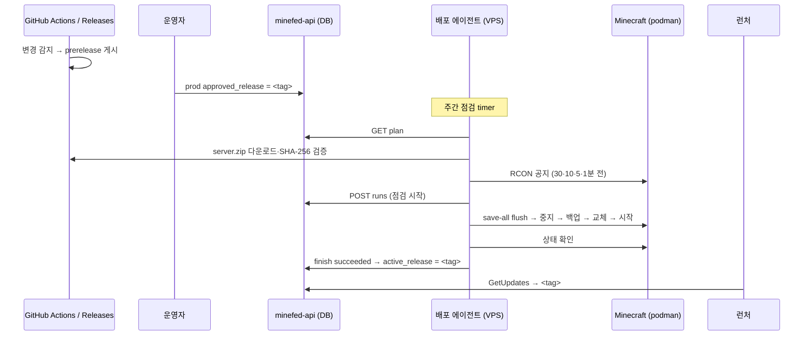

# 운영 서버 예약 배포 설계

2026-10-15 작성. minefed-api 1~4단계와 mods 7단계(배포 에이전트)를 구현했으며 운영 DB·API·VPS 변경은 하지 않았다
([진행 상황](#진행-상황)). 이 문서는 `minefed/mods`,
`minefed/minefed-api`, `minefed/minefed-launcher` 세 저장소와 운영 VPS에 걸친 변경의 기준이다.
각 저장소의 작업은 해당 저장소의 `AGENTS.md`를 따른다. 운영 서버·운영 DB의 변경과 설치는
단계마다 별도 요청이 있을 때만 수행한다.

## 1. 배경

현재 흐름은 다음과 같다.

- `release.yml`은 root `main` push와 15분 간격의 하위 브랜치 확인으로 입력 지문을 비교하고,
  바뀌었으면 `server.zip`, `client.mrpack`, `resourcepack.zip`을 GitHub Release로 게시한다.
  지문에 root 커밋이 포함되므로 문서만 바꾼 root 커밋도 새 릴리스가 된다.
- 게시 마지막 단계에서 `make_latest: 'true'`로 바로 최신 릴리스가 된다
  ([release_control.py](../scripts/release_control.py)의 `publish`).
- minefed-api의 `GetUpdates`는 운영 프로필(`release_channel = 'stable'`)에 GitHub
  `releases/latest`를, 개발 프로필(`prerelease`)에 가장 최근 prerelease를 반환한다.
- 런처는 시작 시와 15분 간격, 그리고 게임 시작 직전에 업데이트를 확인·설치한다.
- 운영 서버의 모드 교체는 수동이다.

따라서 릴리스가 게시되면 운영 런처는 15~30분 안에 새 클라이언트팩을 받지만, 서버는
운영자가 교체할 때까지 이전 모드 구성을 유지한다. 서버·클라이언트 모드가 달라지는 변경에서는
이 구간 동안 접속 실패나 레지스트리 불일치가 생길 수 있다.

## 2. 목표와 범위

목표:

1. 운영 서버는 **주간 정기 점검 시각**에 **운영자가 승인한 릴리스**만 반영한다.
2. 운영 런처는 서버 교체와 상태 확인이 **성공한 뒤에만** 같은 릴리스를 받는다.
3. 교체나 상태 확인에 실패하면 이전 릴리스로 자동 롤백하고 운영 버전을 바꾸지 않는다.
4. 운영 서버로 들어오는 새 접근 경로를 만들지 않는다. 서버에 GitHub 쓰기 토큰을 두지 않는다.
5. 개발 서버는 새 prerelease를 승인 없이 자동 반영해 운영 승인 전 검증 환경으로 쓴다.

범위 밖:

- Velocity와 `plugins/TCPShield-*.jar`의 배포. 프록시는 별도 호스트·수명주기로 본다.
- `server.properties`, 일반 `config/`, 월드 데이터의 형상 관리. 서버팩도 이들을 포함하지 않는다.
- 런처에 업데이트를 즉시 밀어 넣는 기능. 기존 15분 확인과 게임 시작 전 확인을 그대로 쓴다.

## 3. 결정 사항

| 항목 | 결정 |
| --- | --- |
| 운영 서버 환경 | VPS + rootless podman, podman compose, 자체 Minecraft 이미지 |
| 배포 시각 | 매주 일요일 06:00 KST 정기 점검. 공지는 30·10·5·1분 전 |
| 승인 릴리스가 없는 주 | 같은 시각에 정기 재시작(공지·저장·백업·재시작·상태 확인)만 수행 |
| 운영 반영 대상 | 수동 승인한 릴리스만 다음 점검에 예약 |
| 운영 클라이언트 반영 | 서버 반영 성공과 동시 |
| 기준 상태 | minefed-api DB가 프로필별 승인·적용 릴리스를 소유 (B안) |
| 실행 주체 | VPS의 systemd user timer가 실행하는 pull 방식 배포 에이전트 |
| 서버 리소스팩 | 자체 호스팅 고정 URL 대신 태그별 GitHub Release URL. 에이전트가 URL·SHA-1을 갱신 |
| 상태 확인 중 접속 차단 | 점검용 빈 화이트리스트. OP만 접속 가능 |
| 백업 | 배포·재시작 직전 `tar` + zstd, 같은 VPS에 최근 4개 보존 |
| 알림 | 별도 채널 없음. journald 로그와 API 실행 기록으로 확인 |

결정 과정과 남은 확인 항목은 [결정 기록](#13-결정-기록)에 있다.

GitHub `latest` 플래그만 쓰는 A안은 서버에 `contents: write` 토큰이 필요하고 승인 기록을 둘 곳이
없어 택하지 않았다. GitHub Actions의 `schedule`과 SSH로 밀어 넣는 방식은 공개 저장소에 운영
접속 키를 두어야 하고 실행 시각이 늦어질 수 있어 택하지 않았다.

## 4. 전체 구조



| 구성 요소 | 저장소 | 역할 |
| --- | --- | --- |
| 릴리스 게시 | mods `release.yml`, `release_control.py` | 새 릴리스를 prerelease로 게시 |
| 배포 상태와 서버 배포 API | minefed-api | 승인·적용 릴리스, 실행 기록, 점검 상태, `GetUpdates` 고정 |
| 배포 에이전트 | mods `deploy/server-agent/` (신규) | 다운로드·검증·공지·교체·상태 확인·롤백 |
| 런처 | minefed-launcher | 변경 없음. API가 돌려주는 릴리스를 설치 |

에이전트는 서버팩 형식(`MINEFED-RELEASE.json`, `install-mods.py`)에 직접 의존하므로 팩을
만드는 mods 저장소에 둔다. 비밀값은 코드에 포함하지 않으며 VPS의 설정·자격 파일로 주입한다.

## 5. minefed-api 상태 모델

새 마이그레이션 `000004_deployments`를 추가한다.

`launcher_profiles` 추가 열:

| 열 | 형식 | 의미 |
| --- | --- | --- |
| `active_release` | `text NULL` | 런처에 제공하고 서버가 실행 중인 릴리스 태그. NULL이면 기존 채널 동작 |
| `approved_release` | `text NULL` | 다음 배포에서 적용할 태그 |
| `approved_at`, `approved_by` | `timestamptz NULL`, `text NULL` | 승인 기록 |
| `approval_mode` | `text NOT NULL DEFAULT 'manual'` | `manual` 또는 `auto` (`auto`는 최신 prerelease를 승인으로 간주) |

태그는 기존 `safeTag` 규칙을 따르며 현재 버전 형식 `^[0-9]{14}$`도 검사한다.
운영 프로필의 `release_channel = 'stable'` 제약은 유지한다. `active_release`가 NULL일 때만 채널을 쓴다.

`deployment_runs` 테이블:

| 열 | 의미 |
| --- | --- |
| `id uuid` | 실행 ID |
| `profile_id` | 대상 프로필 |
| `kind` | `deploy`(릴리스 교체) 또는 `restart`(승인 릴리스가 없는 주의 정기 재시작) |
| `target_release`, `previous_release` | 적용하려는 태그와 시작 시점의 `active_release` |
| `state` | `running`, `succeeded`, `rolled_back`, `failed`, `aborted` |
| `started_at`, `lease_expires_at`, `finished_at` | 시각과 실행 임대 만료 |
| `server_manifest_sha256` | 적용한 서버팩 manifest 해시 |
| `agent`, `message` | 에이전트 호스트 이름과 결과 요약 (비밀값 금지) |

프로필당 `state = 'running'`은 하나만 허용하는 부분 유일 인덱스를 둔다. 임대가 만료된 실행은
다음 시작 요청이 `aborted`로 닫고 새 실행을 만들 수 있다.

### `GetUpdates` 변경

- `active_release`가 있으면 GitHub `releases/tags/{tag}`로 해당 릴리스를 조회해 반환한다.
  prerelease여도 허용한다. 기존 `validate` 규칙과 실패 시 차단(fail closed)을 그대로 적용한다.
- 없으면 기존처럼 채널의 최신 릴리스를 반환한다. 전환 기간의 호환 경로다.
- 태그별 성공 결과는 릴리스가 바뀌지 않으므로 기존 1분보다 길게(예: 10분) 캐시해도 된다.
  프로필의 `active_release`는 기존처럼 요청마다 DB에서 읽는다.
- 런처용 응답은 지금처럼 `client`, `resourcepack` 두 asset만 반환한다. 서버 배포 API용으로는
  `server.zip`도 같은 규칙(URL·`uploaded`·크기·`sha256:` digest)으로 검증해 반환하는 별도
  함수를 둔다.

런처는 설치된 버전과 응답 버전을 `!==`로만 비교한다(`launcher/src/core/controller.js`).
따라서 롤백으로 더 오래된 태그가 활성화되어도 그 태그로 다시 설치한다.

## 6. 서버 배포 API

regions·transit와 같은 선택적 HTTP/JSON 리스너 패턴을 따른다. 기본값은 비활성화다.

| 환경 변수 | 의미 |
| --- | --- |
| `DEPLOY_HTTP_ADDRESS` | 리스너 주소. 비우면 비활성 |
| `DEPLOY_PROD_TOKEN`, `DEPLOY_DEV_TOKEN` | 프로필별 서버 전용 Bearer. 32~4096자, 공백·쉼표 금지 |
| `DEPLOY_TLS_CERT_FILE`, `DEPLOY_TLS_KEY_FILE` | 기존 리스너와 같은 TLS 구성 |

토큰이 프로필을 결정한다. 경로의 프로필과 토큰의 프로필이 다르면 404로 응답한다.
API 세션 토큰, `GRPC_AUTH_TOKENS`, `REGIONS_SERVER_TOKEN`은 이 자격을 대신하지 않는다.
서버 자격으로는 **승인할 수 없다.** 탈취된 서버 자격으로도 승인되지 않은 태그를 배포하거나
런처에 제공할 수 없다.

| 요청 | 동작 |
| --- | --- |
| `GET /v1/deployments/{profile}/plan` | `activeRelease`, `approvedRelease`(`auto`이면 최신 prerelease), 대상 릴리스의 `server`·`resourcepack` asset(URL·크기·SHA-256), 진행 중 실행, 점검 상태 |
| `POST /v1/deployments/{profile}/runs` | 본문 `kind`, `targetRelease`, `previousRelease`, `agent`. `deploy`는 `target = approved`이고 `previous = active`일 때, `restart`는 `target = previous = active`일 때만 201과 `runId`, 그렇지 않으면 409. 성공 시 점검 상태를 켠다 |
| `POST /v1/deployments/{profile}/runs/{id}/heartbeat` | 임대 연장 |
| `POST /v1/deployments/{profile}/runs/{id}/finish` | 본문 `result`(`succeeded`·`rolled_back`·`failed`), `serverManifestSha256`, `message`. 결과는 아래 표와 같다 |

| 결과 | `active_release` | `approved_release` | 점검 상태 |
| --- | --- | --- | --- |
| `succeeded` | 대상 태그로 갱신 | 같은 태그면 비움 | 해제 |
| `rolled_back` | 유지 | 유지 (다음 점검에 재시도할지는 운영자가 결정) | 해제 |
| `failed` (롤백도 실패) | 유지 | 유지 | **유지** |

`restart` 실행은 릴리스 상태를 바꾸지 않고 점검 상태만 켜고 끈다. 별도 알림 채널을 두지 않으므로
`failed`의 신호는 런처·API의 점검 표시, `deployment_runs` 기록과 VPS journald 로그다.

모든 상태 변경은 한 트랜잭션에서 `running` 실행과 `previous_release = active_release`를 다시
확인한다(compare-and-set). 동시에 다른 경로로 `active_release`가 바뀌었으면 409로 거부한다.

### 승인

1단계는 기존 공지·점검과 같이 운영자가 SQL로 승인한다. 문서
(`docs/LAUNCHER_DATABASE.md`)에 승인·취소 예제를 추가한다.

```sql
UPDATE launcher_profiles
SET approved_release = '<TAG>', approved_at = now(), approved_by = '<OPERATOR>'
WHERE id = 'prod';
-- 승인 취소:
UPDATE launcher_profiles
SET approved_release = NULL, approved_at = NULL, approved_by = NULL
WHERE id = 'prod';
```

후속 단계에서 GitHub의 태그와 asset을 검증한 뒤 기록하는 관리 CLI를 추가할 수 있다.
관리 경로는 인터넷에 공개하지 않는다.

## 7. mods 저장소 변경

### 릴리스 게시

`release_control.py publish`가 draft를 `{'draft': False, 'prerelease': True, 'make_latest': 'false'}`로
공개하도록 바꾸고 관련 테스트를 갱신한다. 개발 프로필은 지금처럼 최신 prerelease를 받는다.
운영 프로필은 API의 `active_release`를 따른다.

이 변경은 **API의 `GetUpdates` 고정이 운영에 배포되고 운영 `active_release`가 설정된 뒤에만**
병합한다. 순서가 바뀌면 운영 런처가 `releases/latest`에 머물러 새 릴리스를 받지 못한다.

이 변경 후 GitHub의 `latest` 표시는 마지막 stable 릴리스에 고정된다. 공개 페이지의 표시를 맞추는
동기화는 [작업 순서](#12-작업-순서) 11단계의 선택 항목이다.

### 배포 에이전트

`deploy/server-agent/`에 Python 3.11 표준 라이브러리만 쓰는 에이전트를 둔다.

- 실행 계정: rootless podman을 실행하는 사용자. 시스템 설정 대신 사용자 홈 아래에 둔다.
  아래에서 `<DEPLOY_ROOT>`는 예시 `~/minefed-deploy`다.
- 설정: `~/.config/minefed-deploy/<profile>.toml`. API URL, 토큰 파일 경로, compose 프로젝트 경로와
  서비스 이름, 서버 루트의 호스트 경로, RCON 주소, `<DEPLOY_ROOT>`, 공지 일정, 제한 시간,
  정기 재시작 여부, 보존 개수를 담는다.
- 자격: 토큰은 소유자만 읽을 수 있는(`0600`) 파일로 두고 경로만 설정에 적는다. 로그에 출력하지 않는다.
- RCON: 자체 이미지라 `rcon-cli`를 가정하지 않는다. 에이전트에 RCON 프로토콜 클라이언트를 내장하고
  `127.0.0.1`에만 게시한 RCON 포트로 접속한다. RCON 비밀번호도 `0600` 파일로 둔다.
- 서버 루트의 파일(`server.properties`, `whitelist.json`, 월드)의 소유자가 컨테이너 안 사용자에
  대응하는 subuid라면 `podman unshare` 안에서 읽고 쓴다.
- 동시 실행 방지: 프로필별 `flock`과 API 실행 임대를 함께 쓴다.
- `--dry-run`: 다운로드·검증·공지 문구 출력까지만 하고 중지·교체·API 상태 변경을 하지 않는다.
- 로그: 표준 출력으로 단계별 결과를 남기고 journald가 수집한다. 별도 알림은 보내지 않는다.
- 테스트: 가짜 API·가짜 `podman`·가짜 RCON으로 배포 성공, 정기 재시작, 롤백, 롤백 실패, 임대 충돌,
  해시 불일치, 디스크 부족, 설정 파일 복원을 검증한다.

systemd user 단위(`~/.config/systemd/user/`, `loginctl enable-linger <user>` 필요):

| 단위 | 일정 |
| --- | --- |
| `minefed-deploy@.service` | 프로필을 인스턴스 이름으로 받는 oneshot |
| `minefed-deploy-prod.timer` | `OnCalendar=Sun *-*-* 05:30:00 Asia/Seoul`, `Persistent=false` |
| `minefed-deploy-dev.timer` | 15분 간격 (`OnCalendar=*:0/15`), 정기 재시작 없음 |

운영 timer는 `Persistent=false`로 둔다. VPS가 꺼져 있어 놓친 점검을 부팅 직후 실행하지 않는다.

### compose 변경

현재 마운트 구조와 무관하게 쓰도록 Minecraft 서비스에 bind mount를 하나 추가한다.

```yaml
volumes:
  - <DEPLOY_ROOT>/current/mods:<컨테이너 안 서버 루트>/mods:ro
```

서버 루트 전체를 bind mount하거나 named volume을 쓰는 경우에도 이 마운트가 `mods/`만 덮는다.
`current`는 `<DEPLOY_ROOT>/releases/<tag>`를 가리키는 심볼릭 링크이며, 링크는 컨테이너 생성 시
해석되므로 교체 후 `podman compose down`과 `up -d`로 컨테이너를 다시 만든다. SELinux가 켜진
호스트면 레이블 옵션을 추가한다. 읽기 전용 마운트에서 쓰기를 시도하는 모드가 확인되면 `:ro`를 뺀다.
최초 설치 때 기존 `mods/`와 [최근 릴리스](https://github.com/minefed/mods/releases)의 서버팩이
같은지 확인한 뒤 전환한다.

## 8. 운영 배포 절차

점검 시각 T는 일요일 06:00 KST다. timer는 T-30분(05:30)에 에이전트를 시작한다.

1. **계획 확인:** `GET plan`. 승인된 릴리스가 `active`와 다르면 `deploy`, 없거나 같으면 `restart`로 진행한다.
2. **사전 준비 (`deploy`만):** 대상 `server.zip`과 `resourcepack.zip`을 내려받아 크기·SHA-256을 확인한다.
   `server.zip`은 `<DEPLOY_ROOT>/releases/<tag>/`에 풀고 `MINEFED-RELEASE.json`의 `side = server`와
   `version = <tag>`를 확인한다. 내려받은 코드를 실행하지 않고 `download-manifest.json`의 모든 관리 파일
   해시와 `mods/` 구성을 에이전트가 직접 검사한다. `resourcepack.zip`의 SHA-1을 계산한다.
   실패하면 공지 없이 중단한다.
3. **디스크 확인:** 직전 백업 크기의 1.5배와 새 릴리스 크기만큼 여유가 없으면 공지 없이 중단한다.
4. **변경 범위:** 클라이언트만 바뀐 릴리스도 같은 절차로 교체한다. 서버 파일 내용이 같으므로 교체는
   결과를 바꾸지 않고, 어차피 재시작하므로 별도 비교를 두지 않는다.
5. **공지:** T-30, T-10, T-5, T-1분에 RCON `say`로 알린다. `deploy`와 `restart`의 문구를 구분한다.
6. **점검 시작 (T):** `POST runs`. 409이면 중단한다. RCON `save-all flush` 후
   `podman compose stop`을 실행한다. 정해진 시간 안에 멈추지 않으면 강제 종료하지 않고
   `failed`로 보고한 뒤 중단한다.
7. **백업:** 월드(`level-name`의 디렉터리)와 `server.properties`, `whitelist.json`,
   `config/bluemap/packs/10-minefed.zip`을 `tar` + zstd로 `<DEPLOY_ROOT>/backups/`에 저장한다.
   BlueMap 렌더 결과처럼 다시 만들 수 있는 데이터는 제외한다. 최근 4개만 남긴다.
   백업에 실패하면 변경 없이 다시 시작하고 `rolled_back`으로 보고한다.
8. **접속 차단:** `whitelist.json`을 보관하고 빈 목록(`[]`)으로 바꾼다. `server.properties`의
   `white-list`, `enforce-whitelist`의 원래 값을 기록하고 둘 다 `true`로 둔다.
   바닐라 규칙상 OP는 화이트리스트를 우회하므로 운영자만 접속할 수 있다.
9. **교체 (`deploy`이고 서버 변경이 있을 때):** 서버팩이 관리하는 경로와 리소스팩 설정만 바꾼다.
   - `mods/`: `current` 링크를 `releases/<tag>`로 바꾼다.
   - `config/bluemap/packs/10-minefed.zip`, `config/mtr/bluemap-vehicles.json`: 새 파일로 바꾼다.
   - `config/mtr/bluemap-public-routes.json`: 운영자가 편집하는 파일이므로 없을 때만 만든다.
   - `server.properties`: `resource-pack`을
     `https://github.com/minefed/mods/releases/download/<tag>/resourcepack.zip`으로,
     `resource-pack-sha1`을 2단계에서 계산한 값으로 바꾼다. `resource-pack-id`는 태그에서
     결정적으로 만든 UUID로 바꾼다. 그 밖의 키와 `config/`, 월드는 건드리지 않는다.
10. **시작과 상태 확인:** `podman compose down`, `up -d` 후 제한 시간(예: 10분) 안에 다음을 모두 확인한다.
    - 이번 시작 이후 로그의 `Done (`
    - 새 crash report, Mixin 적용 실패, 모드 해석 오류가 없음
    - 백엔드 포트의 Server List Ping 응답
    - RCON `list` 응답
11. **접속 허용:** 보관한 `whitelist.json`을 되돌리고 RCON `whitelist reload`를 실행한다.
    원래 `white-list`가 꺼져 있었다면 `whitelist off`를 실행한다. `server.properties`의 두 값도
    원래대로 되돌려 다음 시작에 영향을 주지 않게 한다.
12. **성공:** `finish succeeded`. `deploy`면 API가 `active_release`를 바꾸고, 두 경우 모두 점검을 해제한다.
    런처는 다음 확인이나 게임 시작 전 확인에서 새 클라이언트팩을 받는다.
13. **실패:** 링크, 관리 파일, `server.properties`를 되돌린다. 새 버전이 월드를 불러왔을 수
    있으므로 7단계의 월드 백업도 복원한 뒤 컨테이너를 다시 만들고 같은 상태 확인을 한다. 통과하면
    11단계를 수행하고 `rolled_back`, 통과하지 못하면 화이트리스트를 유지한 채 `failed`로 보고한다.

별도 알림은 보내지 않는다. 결과는 `journalctl --user -u minefed-deploy@prod`, API의
`deployment_runs`, 런처의 점검 표시로 확인한다. 오래된 `releases/<tag>`는 현재·직전 릴리스를 포함해
최근 4개만 남긴다.

## 9. 개발 서버

개발 프로필은 `approval_mode = 'auto'`로 둔다. 같은 에이전트가 15분마다 최신 prerelease와
`active_release`를 비교해, 다르면 짧은 공지(예: 1분) 후 같은 절차로 반영한다. 정기 재시작은 하지 않는다.
개발 런처도 `active_release`를 받으므로 개발 서버와 클라이언트가 같은 릴리스를 쓴다.
운영 승인은 개발 서버에서 확인한 태그를 기준으로 한다.

## 10. 런처

코드 변경은 필요 없다. `GetUpdates`의 응답 형식이 같고 버전은 같음 여부로만 비교한다.
다음은 확인 항목이다.

- 운영 `active_release`를 이전 태그로 되돌렸을 때 다시 설치되는지 실제 런처로 확인한다.
- 점검 상태 표시가 배포 중 `maintenance`로 바뀌는지 확인한다.
- GitHub Release URL의 서버 리소스팩을 1.20.4 클라이언트가 리다이렉트를 따라 받아 적용하는지
  개발 서버에서 확인한다. 실패하면 운영 전환 전에 리소스팩 제공 방식을 다시 정한다.
- 다음 점검 일정 표시는 범위 밖이다. 필요하면 기존 `maintenance` 공지로 안내한다.

## 11. 보안

- 에이전트는 API(HTTPS)와 GitHub Releases로 나가는 연결만 쓴다. 운영 서버로 들어오는 경로를 추가하지 않는다.
- 서버 자격은 프로필 하나에 묶이고 승인 권한이 없다. 배포 가능한 태그는 운영자가 승인한 것뿐이다.
- 다운로드한 서버팩은 GitHub asset digest(SHA-256)와 서버팩 내부 해시로 이중 검증한다.
- 토큰 파일은 소유자 전용 권한으로 두고 저장소·로그·실행 기록 `message`에 남기지 않는다.

## 12. 작업 순서

각 단계는 저장소별로 작은 커밋으로 나누고, 운영 반영(★)은 별도 요청이 있을 때만 수행한다.

| 단계 | 저장소 | 작업 | 완료 조건 |
| --- | --- | --- | --- |
| 0 | — | 설계 결정 | 완료 (2026-10-15, [결정 기록](#13-결정-기록)) |
| 1 | minefed-api | 마이그레이션 `000004_deployments`와 복구 SQL | 격리 DB에서 up/down 확인 |
| 2 | minefed-api | `releases` 태그 조회·`server` asset 검증, `GetUpdates`의 `active_release` 고정 | NULL일 때 기존 동작 유지 테스트 포함 `go test ./...` |
| 3 | minefed-api | 서버 배포 HTTP 리스너와 실행 상태 전이 | 인증 누락·불일치, 409, 임대 만료, 결과별 전이 테스트 |
| 4 | minefed-api | `DEPLOYMENT_API.md`, `LAUNCHER_DATABASE.md`, `compose.prod.yml` 환경 변수 | 문서·설정 검증 |
| 5★ | 운영 | API 배포, 마이그레이션 적용, 운영·개발 `active_release`를 현재 릴리스로 설정 | 런처가 받는 릴리스가 바뀌지 않음 |
| 6 | minefed-launcher | 이전 태그 롤백과 점검 표시 확인 (코드 변경 없음 예상) | 확인 결과 기록 |
| 7 | mods | `deploy/server-agent/`, systemd 단위, 테스트, 설치 안내 | 가짜 API·podman 테스트 통과, `--dry-run` 확인 |
| 8★ | 개발 VPS | compose 마운트 추가, 에이전트 설치, `auto` 모드, 실제 prerelease 몇 회 반영 | 성공·롤백 경로와 GitHub URL 리소스팩 적용을 한 번씩 확인 |
| 9 | mods | `release_control.py`의 prerelease 게시와 `RELEASING.md` 갱신 | 5단계가 운영에 반영된 뒤 병합 |
| 10★ | 운영 VPS | compose 마운트 추가, `resource-pack`을 GitHub URL로 전환, 에이전트와 운영 timer 설치. 첫 점검은 `--dry-run`, 다음 점검부터 실제 실행 | 첫 실제 점검 성공 기록 |
| 11 | 선택 | GitHub `latest` 표시 동기화, 승인 관리 CLI, 점검 공지 자동 등록, 외부 알림 채널 | 필요 시 개별 결정 |

### 진행 상황

2026-10-15 기준이다.

| 단계 | 상태 | 기록 |
| --- | --- | --- |
| 0 | 완료 | [결정 기록](#13-결정-기록) |
| 1~2 | 완료 | minefed-api `3574837`~`c30524f` (마이그레이션, 태그 조회, `GetUpdates` 고정, 로컬 검증 환경, 문서) |
| 3~4 | 완료 | minefed-api `4ce16be`~`10cc046` (서버 팩 검증, 실행 기록 저장소, 배포 API, 리스너 연결, 배포 설정, `docs/DEPLOYMENT_API.md`) |
| 5★ | 대기 | 운영 적용 요청 필요 |
| 7 | 완료 | mods `bb021f4`, `63029bc` (`deploy/server-agent/`: 에이전트, 테스트, systemd 단위, 설정 예시, 설치 안내) |
| 6, 8~11 | 대기 | 6단계(런처 확인)와 8단계(개발 VPS 설치)는 5단계 운영 적용 뒤 진행 |

검증 범위:

- `go vet ./...`, `go test ./...`를 격리 PostgreSQL 16과 함께 통과했다. 마이그레이션 적용·제약·롤백·재적용,
  배포 시작·중복 거부·임대 만료·하트비트·결과별 전이·compare-and-set·운영자 점검 보존을 포함한다.
- 실제 서버 바이너리와 실제 GitHub 릴리스 `20261006092816`으로 계획 조회(`server.zip`·`resourcepack.zip`
  digest 포함), 인증 실패 401, 시작, 중복 409, 하트비트, 완료 후 `active_release` 변경을 확인했다.
- 배포 스크립트 테스트는 Linux 컨테이너에서 72개 중 71개가 통과했다. 남은 1개는 컨테이너 OpenSSL의
  `-days -1` 미지원으로 변경 전 코드에서도 같은 테스트가 실패한다.
- 배포 에이전트 테스트 20개가 Linux 컨테이너의 Python 3.11·3.12에서 통과했다. 가짜 API·podman·RCON·백업으로
  배포 성공, 정기 재시작, 롤백, 롤백 실패, 접속 복구 실패, 시작 거부, 서버팩 변조·경로 탈출, dry run 등을 확인한다.
- 실제 GNU tar + zstd로 백업·제외 경로·복원·보존 개수를, `systemd-analyze`로 단위 문법과
  운영 timer 일정(다음 실행 일요일 05:30 KST)을 확인했다.
- 운영 DB, 운영 API, nginx, VPS, 실제 Minecraft 서버, 실제 런처 동작은 검증하지 않았다.

구현하며 정한 세부 사항:

- 마이그레이션은 개발 프로필의 `approval_mode`를 `auto`로 설정하고, 운영은 DB 제약으로 `manual`만 허용한다.
- 배포 API 리스너는 `DEPLOY_HTTP_ADDRESS`, `DEPLOY_PROD_TOKEN`, `DEPLOY_DEV_TOKEN`으로 켠다. 지정한 토큰의
  프로필만 열린다. 운영 배포 스크립트는 `127.0.0.1` 리스너만 허용한다.
- 점검 문구는 실행 종류별로 고정한다. 실행이 끝나면 그 문구가 그대로 남아 있을 때만 점검을 해제한다.
- 30분 동안 하트비트가 없는 실행은 별도 정리 작업 없이 다음 시작 요청이 `aborted`로 닫는다.
- 5단계에서 API를 배포하기 전에 운영 DB에 `000004`를 먼저 적용한다. 새 API는 이 스키마가 없으면
  시작하지 않고, 이전 API는 이 스키마에서도 동작한다.
- 8·10단계에서 에이전트를 연결할 때 운영 nginx에 `/v1/deployments/` 전달과 `DEPLOY_*` 설정이 필요하다.
- 에이전트는 처음 쓸 때 `--adopt`로 현재 실행 중인 릴리스의 `server.zip`을 `releases/<태그>`로 등록해야 한다.
  `current` 링크가 활성 릴리스를 가리키지 않으면 공지·중지 전에 중단한다.
- 새 서버 로그는 시작 전 `logs/latest.log`와 다른 파일(inode)인지로 판별해 이전 실행의 `Done (`를 오인하지 않는다.
- 서버가 정상인데 접속 복구(RCON `whitelist`)만 실패하면 롤백하지 않고 성공을 보고하며 종료 코드 1로 남긴다.
- 설정 `dry_run = true`면 timer 실행도 준비만 한다. 운영 첫 점검에 사용한다.
- 백업 대상은 월드, `server.properties`, `whitelist.json`, 관리 파일뿐이며 BlueMap 렌더 결과는 포함하지 않는다.
- 에이전트 사용법은 [`deploy/server-agent/README.md`](../deploy/server-agent/README.md)에 있다.

## 13. 결정 기록

2026-10-15 운영자와 정한 내용이다.

| 질문 | 결정 | 근거·영향 |
| --- | --- | --- |
| 점검 일정 | 매주 일요일 06:00 KST, 공지 30·10·5·1분 전 | 운영 timer는 05:30에 시작 |
| 승인 릴리스가 없는 주 | 정기 재시작 | MTR·웹 화면 등의 누적 메모리 정리와 주간 백업 확보. API에는 `restart` 실행으로 기록 |
| podman 구성 | rootless, 자체 이미지 | systemd user 단위와 linger, 내장 RCON 클라이언트, 필요 시 `podman unshare` |
| 데이터 마운트 | 확인 전 | 구조와 무관한 `mods/` 전용 bind mount를 추가하는 방식으로 설계 |
| 서버 리소스팩 | 자체 호스팅 고정 URL을 태그별 GitHub Release URL로 전환 | 에이전트가 `resource-pack`·`resource-pack-sha1`·`resource-pack-id`를 함께 바꾸고 롤백 |
| 상태 확인 중 접속 차단 | 점검용 빈 화이트리스트 | 백엔드만으로 완결. OP만 접속 가능 |
| 백업 | `tar` + zstd, 같은 VPS에 최근 4개 | 디스크 여유를 사전 확인. VPS 장애에는 대비하지 못함 |
| 알림 | 로그만 | journald, `deployment_runs`, 런처 점검 표시로 확인. 일요일 새벽 실패는 운영자가 직접 확인해야 발견됨 |

설치 단계(8★, 10★)에서 확인할 항목:

1. 실제 compose 파일의 서비스 이름, 컨테이너 안 서버 루트 경로, 기존 볼륨 구성.
2. 서버 루트 파일의 소유자와 `podman unshare` 필요 여부.
3. RCON 활성화 여부와 `127.0.0.1` 전용 포트 게시.
4. 현재 `server.properties`의 `resource-pack` 관련 값과 `require-resource-pack`.
5. 백업 4개를 보관할 디스크 여유와 BlueMap 렌더 결과 등 제외할 경로.
